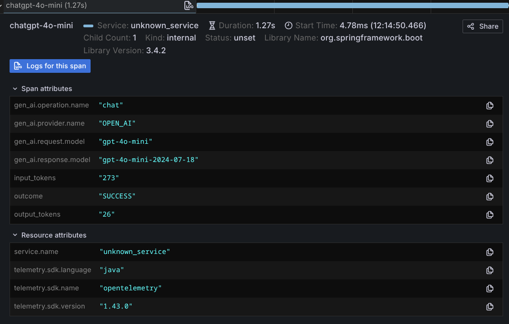

# Observability

## AI Service Observability

:::note
AI Service observability is an experimental feature. Its API and behavior may change in future versions.
:::

AI Service observability mechanisms allow users to track what is happening during an `AiService` invocation. A single invocation may involve multiple LLM invocations, any of which may succeed or fail. AI Service observability allows users to track the full sequence of invocations and their outcomes.

:::note
The AI Service observability capabilities are only available when using [AI Services](/tutorials/ai-services). They are a higher-level construct that can not be applied to a `ChatModel` or `StreamingChatModel`.
:::

The implementation was originally implemented in the [Quarkus LangChain4j extension](https://docs.quarkiverse.io/quarkus-langchain4j/dev/) and was backported here.

### Types of events

Each type of event has a unique identifier, which can be used to correlate events across multiple invocations.
Each type of event includes information encapsulated inside an
[`InvocationContext`](https://github.com/langchain4j/langchain4j/blob/main/langchain4j-core/src/main/java/dev/langchain4j/invocation/InvocationContext.java).

The following types of events are currently available:

| Event Name                                                                                                                                                                                          | Description                                                                                                                                                                                                                                                                                                                                                                                                                                                                                                                                                                                                                   |
|-----------------------------------------------------------------------------------------------------------------------------------------------------------------------------------------------------|-------------------------------------------------------------------------------------------------------------------------------------------------------------------------------------------------------------------------------------------------------------------------------------------------------------------------------------------------------------------------------------------------------------------------------------------------------------------------------------------------------------------------------------------------------------------------------------------------------------------------------|
| [`AiServiceStartedEvent`](https://github.com/langchain4j/langchain4j/blob/main/langchain4j-core/src/main/java/dev/langchain4j/observability/api/event/AiServiceStartedEvent.java)                   | Invoked when an LLM invocation has started.                                                                                                                                                                                                                                                                                                                                                                                                                                                                                                                                                                                   |
| [`AiServiceRequestIssuedEvent`](https://github.com/langchain4j/langchain4j/blob/main/langchain4j-core/src/main/java/dev/langchain4j/observability/api/event/AiServiceRequestIssuedEvent.java)       | Invoked just before a request to an LLM is sent. Contains the details of the request being made. It is important to note that this can be invoked multiple times during a single AiService invocation when tools exist or an output guardrail reprompts the LLM.<br/><br/> Contains information such as the system message and the user message.                                                                                                                                                                                                                                                                                                           |
| [`AiServiceResponseReceivedEvent`](https://github.com/langchain4j/langchain4j/blob/main/langchain4j-core/src/main/java/dev/langchain4j/observability/api/event/AiServiceResponseReceivedEvent.java) | Invoked when a response from an LLM is received. Contains the LLM response along with the corresponding request. It is important to note that this can be invoked multiple times during a single AiService invocation when tools exist or an output guardrail reprompts the LLM.<br/><br/> Contains information such as the system message and the user message.<br/><br/>Not every invocation will receive this event. If an invocation fails it will receive an [`AiServiceErrorEvent`](https://github.com/langchain4j/langchain4j/blob/main/langchain4j-core/src/main/java/dev/langchain4j/observability/api/event/AiServiceErrorEvent.java) instead, and if it is cancelled, an [`AiServiceCancelledEvent`](https://github.com/langchain4j/langchain4j/blob/main/langchain4j-core/src/main/java/dev/langchain4j/observability/api/event/AiServiceCancelledEvent.java). |
| [`AiServiceErrorEvent`](https://github.com/langchain4j/langchain4j/blob/main/langchain4j-core/src/main/java/dev/langchain4j/observability/api/event/AiServiceErrorEvent.java)                       | Fired when an invocation with an LLM fails. The failure could be because of network failure, AiService unavailable, input/output guardrails blocking the request, or many other reasons.<br/><br/>Contains information about the failure that occurred.                                                                                                                                                                                                                                                                                                                                                                       |
| [`AiServiceCompletedEvent`](https://github.com/langchain4j/langchain4j/blob/main/langchain4j-core/src/main/java/dev/langchain4j/observability/api/event/AiServiceCompletedEvent.java)               | Invoked when an LLM invocation has completed successfully.<br/><br/>Not every invocation will receive this event. If an invocation fails it will receive an [`AiServiceErrorEvent`](https://github.com/langchain4j/langchain4j/blob/main/langchain4j-core/src/main/java/dev/langchain4j/observability/api/event/AiServiceErrorEvent.java) instead, and if it is cancelled, an [`AiServiceCancelledEvent`](https://github.com/langchain4j/langchain4j/blob/main/langchain4j-core/src/main/java/dev/langchain4j/observability/api/event/AiServiceCancelledEvent.java).<br/><br/>Contains information about the result of the invocation.                                                                                                                                                                                                          |
| [`AiServiceCancelledEvent`](https://github.com/langchain4j/langchain4j/blob/main/langchain4j-core/src/main/java/dev/langchain4j/observability/api/event/AiServiceCancelledEvent.java) | Invoked when an invocation is cancelled before it completes: the returned `CompletableFuture` or `Flow.Publisher` subscription is cancelled, or `StreamingHandle.cancel()` is called from a `TokenStream` callback that receives a context, such as `onPartialResponseWithContext` (see [Streaming Cancellation](/tutorials/ai-services#streaming-cancellation)). It means that cancellation was requested: the model provider or a tool may still finish work that was already running. A cancelled invocation receives neither an `AiServiceCompletedEvent` nor an `AiServiceErrorEvent`. No token usage is reported for a request that was cancelled, although the provider may still bill for it. Experimental. |
| [`AiServiceInvocationSummaryEvent`](https://github.com/langchain4j/langchain4j/blob/main/langchain4j-core/src/main/java/dev/langchain4j/observability/api/event/AiServiceInvocationSummaryEvent.java) | Invoked once per AiService invocation, after its [`AiServiceCompletedEvent`](https://github.com/langchain4j/langchain4j/blob/main/langchain4j-core/src/main/java/dev/langchain4j/observability/api/event/AiServiceCompletedEvent.java), [`AiServiceErrorEvent`](https://github.com/langchain4j/langchain4j/blob/main/langchain4j-core/src/main/java/dev/langchain4j/observability/api/event/AiServiceErrorEvent.java) or [`AiServiceCancelledEvent`](https://github.com/langchain4j/langchain4j/blob/main/langchain4j-core/src/main/java/dev/langchain4j/observability/api/event/AiServiceCancelledEvent.java).<br/><br/>Contains every event fired during that invocation, in the order they were fired, so the whole invocation can be inspected in one place. This includes the `AiServiceInvocationSummaryEvent`s of AI Services called from that invocation (for example from a tool). See [Listening for the whole invocation](#listening-for-the-whole-invocation) for details.                                                                                   |
| [`ToolExecutedEvent`](https://github.com/langchain4j/langchain4j/blob/main/langchain4j-core/src/main/java/dev/langchain4j/observability/api/event/ToolExecutedEvent.java)                           | Invoked when a tool invocation has completed. It is important to note that this can be invoked multiple times within a single LLM invocation.<br/><br/>Contains information about the tool request and result, and whether the tool execution failed (`isError()`, which throws an `UnsupportedOperationException` if the integration that created the event does not report it; AI Services created with `AiServices` always report it, but code that reads events reflectively, such as a JSON serializer, fails on events from an integration that does not).<br/><br/>Also fired, with `isError()` returning `true`, when a tool error fails the AI Service invocation (for example with `ToolExecutionErrorHandler.failInvocation()`). The result is then the error text, which is not sent to the LLM, and an [`AiServiceErrorEvent`](https://github.com/langchain4j/langchain4j/blob/main/langchain4j-core/src/main/java/dev/langchain4j/observability/api/event/AiServiceErrorEvent.java) follows.                                                                                                                                                                                                                                                                                                                                                                                                                |
| [`ToolCompensatedEvent`](https://github.com/langchain4j/langchain4j/blob/main/langchain4j-core/src/main/java/dev/langchain4j/observability/api/event/ToolCompensatedEvent.java)                           | Invoked when a tool that had already completed is compensated, because the interaction was later cancelled or failed. Experimental; emitted by the non-blocking AI Service modes.<br/><br/>Contains the tool request, its result and the reason for compensation.                           |
| [`RetrievalAugmentedEvent`](https://github.com/langchain4j/langchain4j/blob/main/langchain4j-core/src/main/java/dev/langchain4j/observability/api/event/RetrievalAugmentedEvent.java) | Invoked once per invocation of an AI Service that uses [RAG](/tutorials/rag) (configured with `contentRetriever(...)` or `retrievalAugmentor(...)`), after the contents to add to the user message were retrieved, also when nothing was retrieved. Experimental.<br/><br/>Contains the user message that was used for the retrieval and the retrieved contents (the same contents that a method returning `Result<...>` gives as its sources). To observe each content retriever call with the query it received, use a [`ContentRetrieverListener`](https://github.com/langchain4j/langchain4j/blob/main/langchain4j-core/src/main/java/dev/langchain4j/rag/content/retriever/listener/ContentRetrieverListener.java). |
| [`InputGuardrailExecutedEvent`](https://github.com/langchain4j/langchain4j/blob/main/langchain4j-core/src/main/java/dev/langchain4j/observability/api/event/InputGuardrailExecutedEvent.java)       | Invoked when an [input guardrail](https://docs.langchain4j.dev/tutorials/guardrails#input-guardrails) validation has been executed. One of these events will be fired for each invocation of a guardrail.<br/><br/>Contains information about the input to an individual input guardrail, its output (i.e. was it successful or a failure?), and the execution duration.                                                                                                                                                                                                                                                      |
| [`OutputGuardrailExecutedEvent`](https://github.com/langchain4j/langchain4j/blob/main/langchain4j-core/src/main/java/dev/langchain4j/observability/api/event/OutputGuardrailExecutedEvent.java)     | Invoked when an [output guardrail](https://docs.langchain4j.dev/tutorials/guardrails#output-guardrails) validation has been executed. One of these events will be fired for each invocation of a guardrail.<br/><br/>Contains information about the input to an individual output guardrail, its output (i.e. was it successful? failure? a retry? reprompt?), and the execution duration.                                                                                                                                                                                                                                    |

Every AI Service invocation that runs ends with exactly one of `AiServiceCompletedEvent`, `AiServiceErrorEvent` or `AiServiceCancelledEvent`. Cancelling an invocation that has already completed fires no event. (A `TokenStream` invocation runs, and ends, only once `start()` is called.) Events of work that was already running when the invocation was cancelled (for example a `ToolExecutedEvent`) can still arrive after the `AiServiceCancelledEvent`.

### Listening for an event

Each of the [types of events](#types-of-events) has its own listener that can be implemented to receive the event. You can pick and choose which events you want to listen for.

To listen for an event, create your own class implementing the listener interface you'd like to listen to. These are the available listener interfaces:

| Listener Name                                                                                                                                                                                                | Event                                                                                                                                                                                               |
|--------------------------------------------------------------------------------------------------------------------------------------------------------------------------------------------------------------|-----------------------------------------------------------------------------------------------------------------------------------------------------------------------------------------------------|
| [`AiServiceStartedListener`](https://github.com/langchain4j/langchain4j/blob/main/langchain4j-core/src/main/java/dev/langchain4j/observability/api/listener/AiServiceStartedListener.java)                   | [`AiServiceStartedEvent`](https://github.com/langchain4j/langchain4j/blob/main/langchain4j-core/src/main/java/dev/langchain4j/observability/api/event/AiServiceStartedEvent.java)                   |
| [`AiServiceRequestIssuedListener`](https://github.com/langchain4j/langchain4j/blob/main/langchain4j-core/src/main/java/dev/langchain4j/observability/api/listener/AiServiceRequestIssuedListener.java)       | [`AiServiceRequestIssuedEvent`](https://github.com/langchain4j/langchain4j/blob/main/langchain4j-core/src/main/java/dev/langchain4j/observability/api/event/AiServiceRequestIssuedEvent.java)       |
| [`AiServiceResponseReceivedListener`](https://github.com/langchain4j/langchain4j/blob/main/langchain4j-core/src/main/java/dev/langchain4j/observability/api/listener/AiServiceResponseReceivedListener.java) | [`AiServiceResponseReceivedEvent`](https://github.com/langchain4j/langchain4j/blob/main/langchain4j-core/src/main/java/dev/langchain4j/observability/api/event/AiServiceResponseReceivedEvent.java) |
| [`AiServiceErrorListener`](https://github.com/langchain4j/langchain4j/blob/main/langchain4j-core/src/main/java/dev/langchain4j/observability/api/listener/AiServiceErrorListener.java)                       | [`AiServiceErrorEvent`](https://github.com/langchain4j/langchain4j/blob/main/langchain4j-core/src/main/java/dev/langchain4j/observability/api/event/AiServiceErrorEvent.java)                       |
| [`AiServiceInvocationSummaryListener`](https://github.com/langchain4j/langchain4j/blob/main/langchain4j-core/src/main/java/dev/langchain4j/observability/api/listener/AiServiceInvocationSummaryListener.java) | [`AiServiceInvocationSummaryEvent`](https://github.com/langchain4j/langchain4j/blob/main/langchain4j-core/src/main/java/dev/langchain4j/observability/api/event/AiServiceInvocationSummaryEvent.java)                |
| [`AiServiceCompletedListener`](https://github.com/langchain4j/langchain4j/blob/main/langchain4j-core/src/main/java/dev/langchain4j/observability/api/listener/AiServiceCompletedListener.java)               | [`AiServiceCompletedEvent`](https://github.com/langchain4j/langchain4j/blob/main/langchain4j-core/src/main/java/dev/langchain4j/observability/api/event/AiServiceCompletedEvent.java)               |
| [`AiServiceCancelledListener`](https://github.com/langchain4j/langchain4j/blob/main/langchain4j-core/src/main/java/dev/langchain4j/observability/api/listener/AiServiceCancelledListener.java) | [`AiServiceCancelledEvent`](https://github.com/langchain4j/langchain4j/blob/main/langchain4j-core/src/main/java/dev/langchain4j/observability/api/event/AiServiceCancelledEvent.java) |
| [`ToolExecutedEventListener`](https://github.com/langchain4j/langchain4j/blob/main/langchain4j-core/src/main/java/dev/langchain4j/observability/api/listener/ToolExecutedEventListener.java)                 | [`ToolExecutedEvent`](https://github.com/langchain4j/langchain4j/blob/main/langchain4j-core/src/main/java/dev/langchain4j/observability/api/event/ToolExecutedEvent.java)                           |
| [`ToolCompensatedEventListener`](https://github.com/langchain4j/langchain4j/blob/main/langchain4j-core/src/main/java/dev/langchain4j/observability/api/listener/ToolCompensatedEventListener.java)                 | [`ToolCompensatedEvent`](https://github.com/langchain4j/langchain4j/blob/main/langchain4j-core/src/main/java/dev/langchain4j/observability/api/event/ToolCompensatedEvent.java)                           |
| [`RetrievalAugmentedListener`](https://github.com/langchain4j/langchain4j/blob/main/langchain4j-core/src/main/java/dev/langchain4j/observability/api/listener/RetrievalAugmentedListener.java) | [`RetrievalAugmentedEvent`](https://github.com/langchain4j/langchain4j/blob/main/langchain4j-core/src/main/java/dev/langchain4j/observability/api/event/RetrievalAugmentedEvent.java) |
| [`InputGuardrailExecutedListener`](https://github.com/langchain4j/langchain4j/blob/main/langchain4j-core/src/main/java/dev/langchain4j/observability/api/listener/InputGuardrailExecutedListener.java)       | [`InputGuardrailExecutedEvent`](https://github.com/langchain4j/langchain4j/blob/main/langchain4j-core/src/main/java/dev/langchain4j/observability/api/event/InputGuardrailExecutedEvent.java)       |
| [`OutputGuardrailExecutedListener`](https://github.com/langchain4j/langchain4j/blob/main/langchain4j-core/src/main/java/dev/langchain4j/observability/api/listener/OutputGuardrailExecutedListener.java)     | [`OutputGuardrailExecutedEvent`](https://github.com/langchain4j/langchain4j/blob/main/langchain4j-core/src/main/java/dev/langchain4j/observability/api/event/OutputGuardrailExecutedEvent.java)     |

Once you've defined your listener(s), register them when you create your [AI Services](/tutorials/ai-services). There are various `registerListener` method variants on the [`AiServices` class](https://github.com/langchain4j/langchain4j/blob/main/langchain4j/src/main/java/dev/langchain4j/service/AiServices.java).

For example, you could do the following to create and register a listener for an `AiServiceCompletedEvent`:

```java
import java.time.Instant;
import java.util.List;
import java.util.Optional;
import java.util.UUID;

import dev.langchain4j.observability.api.AiServiceListenerRegistrar;
import dev.langchain4j.observability.api.event.AiServiceCompletedEvent;
import dev.langchain4j.observability.api.listener.AiServiceCompletedListener;
import dev.langchain4j.invocation.InvocationContext;

public class MyAiServiceCompletedListener implements AiServiceCompletedListener {
    @Override
    public void onEvent(AiServiceCompletedEvent event) {
        InvocationContext invocationContext = event.invocationContext();
        Optional<Object> result = event.result();

        // The invocationId will be the same for all events related to the same AI Service invocation
        UUID invocationId = invocationContext.invocationId();
        // If this AI Service was called from inside another AI Service invocation (for example from one of its tools or guardrails):
        // the invocationId of that outer invocation; otherwise null (see "Linking nested invocations" below)
        UUID parentInvocationId = invocationContext.parentInvocationId();
        String aiServiceInterfaceName = invocationContext.interfaceName();
        String aiServiceMethodName = invocationContext.methodName();
        List<Object> aiServiceMethodArgs = invocationContext.methodArguments();
        Object chatMemoryId = invocationContext.chatMemoryId();
        Instant eventTimestamp = invocationContext.timestamp();

        // Do something with the data
    }
}

// When creating your AI Service
MyAiServiceCompletedListener myListener = new MyAiServiceCompletedListener();

var myService = AiServices.builder(MyAiService.class)
        .chatModel(chatModel)  // Could also be .streamingChatModel(...)
        .registerListener(myListener)
        .build();
```

### Listening for the whole invocation

Rather than listening for each individual event, you can register an [`AiServiceInvocationSummaryListener`](https://github.com/langchain4j/langchain4j/blob/main/langchain4j-core/src/main/java/dev/langchain4j/observability/api/listener/AiServiceInvocationSummaryListener.java) to receive a single [`AiServiceInvocationSummaryEvent`](https://github.com/langchain4j/langchain4j/blob/main/langchain4j-core/src/main/java/dev/langchain4j/observability/api/event/AiServiceInvocationSummaryEvent.java) once an invocation is over. Its `events()` method returns every event fired for the invocation (i.e. every event with the same `invocationId`), in the order they were fired, starting with the `AiServiceStartedEvent` and ending with the `AiServiceCompletedEvent`, `AiServiceErrorEvent` or `AiServiceCancelledEvent`. It also contains the other events of the invocation, such as `RetrievalAugmentedEvent`s and `ToolExecutedEvent`s. If the invocation calls other AI Services (for example from a tool), it also contains their `AiServiceInvocationSummaryEvent`s, which have their own `invocationId` (see below).

```java
var myService = AiServices.builder(MyAiService.class)
        .chatModel(chatModel)
        .registerListener((AiServiceInvocationSummaryListener) summary -> {
            UUID invocationId = summary.invocationContext().invocationId();
            List<AiServiceEvent> events = summary.events();

            // Do something with the data
        })
        .build();
```

A few things to keep in mind:

- Events are collected for an invocation if an `AiServiceInvocationSummaryListener` is registered when it starts, or if it is nested in an invocation whose events are collected (see below). Otherwise no events are kept, so there is no overhead if you don't use a summary listener.
- If an asynchronous or streaming invocation is canceled, it ends with an `AiServiceCancelledEvent`, and the `AiServiceInvocationSummaryEvent` contains the events fired up until the cancellation, ending with the `AiServiceCancelledEvent`.
- Events fired for an invocation after it has ended (for example `ToolCompensatedEvent`s fired once a canceled invocation has been rolled back) are not included.
- An AI Service invoked while another AI Service invocation is in progress (for example, from within a tool) is a separate invocation with its own `invocationId`. When it is linked to the outer invocation by `InvocationContext.parentInvocationId()` (see [Linking nested invocations](#linking-nested-invocations)), it is nested in the outer summary:
  - Its `AiServiceInvocationSummaryEvent` is added to the outer invocation's `events()` when the inner invocation ends. The events of the inner invocation are only in that nested summary, which can itself contain the summaries of deeper invocations.
  - It is collected even if only the outer AI Service has a summary listener. Its events are then kept in memory until the outer invocation ends.
  - Its summary is still delivered to the inner AI Service's own listeners. So a listener registered on both AI Services receives the inner summary twice: on its own, and inside the outer summary. When you add up tokens, costs or tool calls, count each invocation only once, for example by skipping the `AiServiceInvocationSummaryEvent`s found in `events()`.
  - A summary listener of the outer AI Service also receives the prompts, responses and tool results of the inner invocations. If you filter or redact what you log or export, do the same for the nested summaries.
  - Inner invocations called from the chat model, the chat memory or its `ChatMemoryStore` are nested. Inner invocations that end before the outer one has fired its `AiServiceStartedEvent` (those called from the `ChatMemoryProvider`, the system or user message provider or the system message transformer), or after the outer one has ended, are linked but not nested.
- For an AI Service method returning a `TokenStream`, the invocation starts when the method is called but only ends once the stream has been started with `start()`. Events collected for a `TokenStream` that is never started are never released, so always start the streams you create. If `start()` fails because of a configuration error (for example, a missing error handler), the invocation ends with an `AiServiceErrorEvent`; calling `start()` again once the configuration is fixed starts a new invocation.
- Each subscription to the reactive stream returned by an AI Service method, and each call of `TokenStream.start()`, is a separate invocation with its own `invocationId`, so it results in its own `AiServiceInvocationSummaryEvent`, also when several subscriptions run at the same time. A second `start()` of the same `TokenStream` reuses the retrieved contents, the input guardrails and the messages prepared when the AI Service method was called, so its summary contains no `RetrievalAugmentedEvent` and no input guardrail events: only the model call, the tools and the output guardrails run again.
- An `AiServiceInvocationSummaryEvent` is fired by the registrar itself. Trying to fire one via `AiServiceListenerRegistrar.fireEvent` results in an `IllegalArgumentException`.

### Linking nested invocations

An AI Service is often called from inside another AI Service, for example from one of its tools.
Each of the two calls is a separate invocation, with its own `invocationId` and its own events.
To link them, the `InvocationContext` of the inner invocation has `parentInvocationId()` (experimental):
the `invocationId` of the outer invocation, or `null` if there is none.

```java
interface Assistant {
    String chat(String message);
}

interface Translator {
    String translate(String text);
}

class TranslationTools {

    private final Translator translator;

    TranslationTools(Translator translator) {
        this.translator = translator;
    }

    @Tool("Translates a text to English")
    String translateToEnglish(String text) {
        return translator.translate(text); // the inner invocation
    }
}

// Collects the summaries of inner invocations, grouped by the invocation that called them
Map<UUID, List<AiServiceInvocationSummaryEvent>> innerByOuter = new ConcurrentHashMap<>();
AiServiceInvocationSummaryListener listener = summary -> {
    UUID parentInvocationId = summary.invocationContext().parentInvocationId();
    if (parentInvocationId != null) {
        innerByOuter.computeIfAbsent(parentInvocationId, id -> new CopyOnWriteArrayList<>()).add(summary);
    }
};

Translator translator = AiServices.builder(Translator.class)
        .chatModel(chatModel)
        .registerListener(listener)
        .build();

Assistant assistant = AiServices.builder(Assistant.class)
        .chatModel(chatModel)
        .tools(new TranslationTools(translator))
        .registerListener(listener)
        .build();
```

The inner invocation is linked to the outer one when it is called from one of these parts of the outer AI Service:
- a tool (`tools`, `toolProvider`), a tool error handler (`toolExecutionErrorHandler`, `toolArgumentsErrorHandler`) or the strategy for hallucinated tool names (`hallucinatedToolNameStrategy`)
- an input or output guardrail (`inputGuardrails`, `outputGuardrails`)
- a component of the retrieval augmentor (`retrievalAugmentor`, `contentRetriever`), for example a query transformer, a query router or a content retriever
- the system or user message provider (`systemMessageProvider`, `userMessageProvider`) or the system message transformer (`systemMessageTransformer`)
- the chat memory (`chatMemory`, `chatMemoryProvider`), including its `ChatMemoryStore`, for example a chat memory that summarizes old messages with an AI Service
- the moderation model (`moderationModel`)
- the `chatRequestTransformer`
- the chat model or streaming chat model itself (`chatModel`, `streamingChatModel`), for example your own `ChatModel` implementation

`parentInvocationId()` is `null`:
- for an AI Service that you call from your own code, for example from inside a listener, a `TokenStream` handler, the subscriber of a returned stream or a callback of a returned `CompletableFuture`, even while the outer invocation is still running
- when your own code in one of the parts above calls the inner AI Service on another thread, for example with `CompletableFuture.supplyAsync(..., executor)`. Work that LangChain4j itself moves to another thread (for example tools executed concurrently) stays linked. So treat the link as best effort.

If you only need the summaries, a summary listener on the outer AI Service is enough: the summaries of the inner invocations linked to it are nested in its `events()` (see [Listening for the whole invocation](#listening-for-the-whole-invocation)).

```java
Assistant assistant = AiServices.builder(Assistant.class)
        .chatModel(chatModel)
        .tools(new TranslationTools(translator))
        .registerListener((AiServiceInvocationSummaryListener) summary -> {
            List<AiServiceInvocationSummaryEvent> innerSummaries = summary.events().stream()
                    .filter(AiServiceInvocationSummaryEvent.class::isInstance)
                    .map(AiServiceInvocationSummaryEvent.class::cast)
                    .toList();
        })
        .build();
```

Limits:
- It is filled by the AI Service implementation that LangChain4j provides. Frameworks that replace that implementation (for example through `AiServicesFactory`) return `null` until they add support for it, also for AI Services they create through `AiServices.builder(...)`.
- Agents run by an agentic workflow (sequence, parallel, loop, conditional) or by a supervisor are not linked yet. An agent called from a tool of another agent is.

### Grouping model calls by invocation

The listeners of models and of other components get the `invocationId` of the AI Service invocation that made the call,
so you can see which model calls belong to which invocation.
The contexts of these listeners have `invocationId()` (experimental):
- `ChatModelListener` (`ChatModelRequestContext`, `ChatModelResponseContext`, `ChatModelErrorContext`)
- `EmbeddingModelListener`, `ModerationModelListener`, `DecisionModelListener` and `ScoringModelListener`
- `EmbeddingStoreListener` and `ContentRetrieverListener`

`invocationId()` is the id of the AI Service invocation in which the call is made: for a chat model, the one passed with
`ChatRequestOptions.invocationId(...)` if any, otherwise the invocation that makes the call (the AI Service's own calls to the
chat model, including the calls after tool executions, and the calls made by its tools, guardrails, retrieval, chat memory,
moderation, ...), otherwise `null`, for example when you call the model directly from your own code or from a listener.
It is the `invocationId` of the AI Service invocation, not an id of the model call.
Together with `parentInvocationId()` (see above), you can build a tree of invocations with their model calls.

```java
// Counts the chat model calls of each AI Service invocation
Map<UUID, AtomicInteger> modelCallsByInvocation = new ConcurrentHashMap<>();

ChatModelListener listener = new ChatModelListener() {

    @Override
    public void onRequest(ChatModelRequestContext requestContext) {
        UUID invocationId = requestContext.invocationId();
        if (invocationId != null) { // null when the model is called outside of an AI Service invocation
            modelCallsByInvocation.computeIfAbsent(invocationId, id -> new AtomicInteger()).incrementAndGet();
        }
    }
};

ChatModel chatModel = OpenAiChatModel.builder()
        .apiKey(System.getenv("OPENAI_API_KEY"))
        .modelName(GPT_4_O_MINI)
        .listeners(List.of(listener))
        .build();

Assistant assistant = AiServices.builder(Assistant.class)
        .chatModel(chatModel)
        .build();
```

To link model calls to something that is known to the AI Service but not to the model, for example the memory id
of the conversation, combine a model listener with AI Service listeners: the `InvocationContext` of the AI Service events
has both the `invocationId()` and the `chatMemoryId()`.

```java
interface PersonalAssistant {

    String chat(@MemoryId String userId, @UserMessage String message);
}

// Adds up the token usage of each conversation
Map<UUID, Object> memoryIdByInvocation = new ConcurrentHashMap<>();
Map<Object, Integer> totalTokensByMemoryId = new ConcurrentHashMap<>();

ChatModelListener tokenCounter = new ChatModelListener() {

    @Override
    public void onResponse(ChatModelResponseContext responseContext) {
        Object memoryId = responseContext.invocationId() == null
                ? null
                : memoryIdByInvocation.get(responseContext.invocationId());
        TokenUsage tokenUsage = responseContext.chatResponse().tokenUsage();
        if (memoryId != null && tokenUsage != null && tokenUsage.totalTokenCount() != null) {
            totalTokensByMemoryId.merge(memoryId, tokenUsage.totalTokenCount(), Integer::sum);
        }
    }
};

ChatModel chatModel = OpenAiChatModel.builder()
        .apiKey(System.getenv("OPENAI_API_KEY"))
        .modelName(GPT_4_O_MINI)
        .listeners(List.of(tokenCounter))
        .build();

PersonalAssistant assistant = AiServices.builder(PersonalAssistant.class)
        .chatModel(chatModel)
        .chatMemoryProvider(memoryId -> MessageWindowChatMemory.withMaxMessages(10))
        .registerListeners(
                (AiServiceStartedListener) event -> memoryIdByInvocation.put(
                        event.invocationContext().invocationId(), event.invocationContext().chatMemoryId()),
                (AiServiceCompletedListener) event -> memoryIdByInvocation.remove(event.invocationContext().invocationId()),
                (AiServiceErrorListener) event -> memoryIdByInvocation.remove(event.invocationContext().invocationId()),
                (AiServiceCancelledListener) event -> memoryIdByInvocation.remove(event.invocationContext().invocationId()))
        .build();
```

The invocation id covers the AI Service's own calls to the chat model, including the calls after tool executions,
and the calls made by the parts of the AI Service listed above (tools, guardrails, retrieval, chat memory, moderation, ...),
in the same way as `parentInvocationId()`.

You only need to pass the id yourself when your code moves a chat model call to another thread
(for example with `CompletableFuture.supplyAsync(..., executor)` inside a tool), or when you want to group your own chat model calls
under an invocation. This is possible only for chat models, with `ChatRequestOptions`: for the other models, embedding stores and
content retrievers, a call that your code moves to another thread has no `invocationId`. A tool gets the `InvocationContext` of its invocation as a parameter, and a guardrail gets it from its request
(`request.requestParams().invocationContext()`):

```java
class ResearchTools {

    private final ChatModel chatModel;
    private final ExecutorService executor;

    ResearchTools(ChatModel chatModel, ExecutorService executor) {
        this.chatModel = chatModel;
        this.executor = executor;
    }

    @Tool("Summarizes a text")
    String summarize(String text, InvocationContext invocationContext) {
        ChatRequest chatRequest = ChatRequest.builder()
                .messages(UserMessage.from("Summarize: " + text))
                .build();
        ChatRequestOptions options = ChatRequestOptions.builder()
                .invocationId(invocationContext.invocationId())
                .build();
        return CompletableFuture.supplyAsync(() -> chatModel.chat(chatRequest, options), executor)
                .join()
                .aiMessage()
                .text();
    }
}
```

Frameworks that run AI Services with their own implementation (for example through `AiServicesFactory`) may not fill the id,
or fill it only for some of the calls, depending on how they call the models.

### Creating your own events and listeners

The AI Service observability capabilities are designed to be extensible. If you'd like to create your own events, you can do so by implementing the [`AiServiceEvent`](https://github.com/langchain4j/langchain4j/blob/main/langchain4j-core/src/main/java/dev/langchain4j/observability/api/event/AiServiceEvent.java) interface to define your own event.

Then, create your own event listener by implementing the [`AiServiceListener`](https://github.com/langchain4j/langchain4j/blob/main/langchain4j-core/src/main/java/dev/langchain4j/observability/api/listener/AiServiceListener.java) interface.

Once you have your event and listener, you need to fire the event by obtaining/managing an instance of `AiServiceListenerRegistrar` and calling the `fireEvent(event)` method.

Once the event is getting fired, you can then create listeners and register your listeners just like you would with the built-in events.

### Extension points

You can also create your own custom [`AiServiceListenerRegistrar`](https://github.com/langchain4j/langchain4j/blob/main/langchain4j-core/src/main/java/dev/langchain4j/observability/api/AiServiceListenerRegistrar.java) by implementing the [`AiServiceListenerRegistrarFactory`](https://github.com/langchain4j/langchain4j/blob/main/langchain4j-core/src/main/java/dev/langchain4j/spi/observability/AiServiceListenerRegistrarFactory.java) and registering it with the [Java Service Provider Interface (Java SPI)](https://www.baeldung.com/java-spi).

This could be useful if you want to manage the way you register/unregister your listeners and/or how you want to fire your events.

## Chat Model Observability

[Certain](/integrations/language-models) implementations of `ChatModel` and `StreamingChatModel`
(see "Observability" column) allow configuring `ChatModelListener`(s) to listen for events such as:
- Requests to the LLM
- Response from the LLM
- Errors

These events include various attributes, as described in the
[OpenTelemetry Generative AI Semantic Conventions](https://opentelemetry.io/docs/specs/semconv/gen-ai/), such as:
- Request:
  - Messages
  - Model
  - Temperature
  - Top P
  - Max Tokens
  - Tools
  - Response Format
  - etc
- Response:
  - Assistant Message
  - ID
  - Model
  - Token Usage
  - Finish Reason
  - etc

Here is an example of using `ChatModelListener`:
```java
ChatModelListener listener = new ChatModelListener() {

    @Override
    public void onRequest(ChatModelRequestContext requestContext) {
        ChatRequest chatRequest = requestContext.chatRequest();

        List<ChatMessage> messages = chatRequest.messages();
        System.out.println(messages);

        ChatRequestParameters parameters = chatRequest.parameters();
        System.out.println(parameters.modelName());
        System.out.println(parameters.temperature());
        System.out.println(parameters.topP());
        System.out.println(parameters.seed());
        System.out.println(parameters.topK());
        System.out.println(parameters.frequencyPenalty());
        System.out.println(parameters.presencePenalty());
        System.out.println(parameters.maxOutputTokens());
        System.out.println(parameters.stopSequences());
        System.out.println(parameters.toolSpecifications());
        System.out.println(parameters.toolChoice());
        System.out.println(parameters.responseFormat());

        if (parameters instanceof OpenAiChatRequestParameters openAiParameters) {
            System.out.println(openAiParameters.maxCompletionTokens());
            System.out.println(openAiParameters.logitBias());
            System.out.println(openAiParameters.parallelToolCalls());
            System.out.println(openAiParameters.user());
            System.out.println(openAiParameters.store());
            System.out.println(openAiParameters.metadata());
            System.out.println(openAiParameters.serviceTier());
            System.out.println(openAiParameters.reasoningEffort());
        }

        System.out.println(requestContext.modelProvider());

        Map<Object, Object> attributes = requestContext.attributes();
        attributes.put("my-attribute", "my-value");
    }

    @Override
    public void onResponse(ChatModelResponseContext responseContext) {
        ChatResponse chatResponse = responseContext.chatResponse();

        AiMessage aiMessage = chatResponse.aiMessage();
        System.out.println(aiMessage);

        ChatResponseMetadata metadata = chatResponse.metadata();
        System.out.println(metadata.id());
        System.out.println(metadata.modelName());
        System.out.println(metadata.finishReason());

        if (metadata instanceof OpenAiChatResponseMetadata openAiMetadata) {
            System.out.println(openAiMetadata.created());
            System.out.println(openAiMetadata.serviceTier());
            System.out.println(openAiMetadata.systemFingerprint());
        }

        TokenUsage tokenUsage = metadata.tokenUsage();
        System.out.println(tokenUsage.inputTokenCount());
        System.out.println(tokenUsage.outputTokenCount());
        System.out.println(tokenUsage.totalTokenCount());
        if (tokenUsage instanceof OpenAiTokenUsage openAiTokenUsage) {
            System.out.println(openAiTokenUsage.inputTokensDetails().cachedTokens());
            System.out.println(openAiTokenUsage.outputTokensDetails().reasoningTokens());
        }

        ChatRequest chatRequest = responseContext.chatRequest();
        System.out.println(chatRequest);

        System.out.println(responseContext.modelProvider());

        Map<Object, Object> attributes = responseContext.attributes();
        System.out.println(attributes.get("my-attribute"));
    }

    @Override
    public void onError(ChatModelErrorContext errorContext) {
        Throwable error = errorContext.error();
        error.printStackTrace();

        ChatRequest chatRequest = errorContext.chatRequest();
        System.out.println(chatRequest);

        System.out.println(errorContext.modelProvider());

        Map<Object, Object> attributes = errorContext.attributes();
        System.out.println(attributes.get("my-attribute"));
    }
};

ChatModel model = OpenAiChatModel.builder()
        .apiKey(System.getenv("OPENAI_API_KEY"))
        .modelName(GPT_4_O_MINI)
        .listeners(List.of(listener))
        .build();

model.chat("Tell me a joke about Java");
```

The `attributes` map allows passing information between the `onRequest`, `onResponse`, and `onError` methods of the same
`ChatModelListener`, as well as between multiple `ChatModelListener`s.
If you need to provide per-invocation metadata to listeners, use `ChatRequestOptions`.
For example, you can pass tenant or correlation identifiers to `ChatModelListener`s
through `listenerAttributes`. These options are used only within the LangChain4j invocation chain;
they are not sent to the LLM provider.

```java
ChatRequest chatRequest = ChatRequest.builder()
        .messages(UserMessage.from("Tell me a joke about Java"))
        .build();

ChatRequestOptions options = ChatRequestOptions.builder()
        .addListenerAttribute("tenantId", "tenant-123")
        .addListenerAttribute("correlationId", "corr-456")
        .build();

model.chat(chatRequest, options);
```

The same applies to `StreamingChatModel.chat(chatRequest, options, handler)`.

### How listeners work

- Listeners are specified as a `List<ChatModelListener>` and are called in the order of iteration.
- Listeners are called synchronously and in the same thread. See more details about the streaming case below.
  The second listener is not called until the first one returns.
- The `ChatModelListener.onRequest()` method is called right before calling the LLM provider API.
- The `ChatModelListener.onRequest()` method is called only once per request.
  If an error occurs while calling the LLM provider API and a retry happens,
  `ChatModelListener.onRequest()` will **_not_** be called for every retry.
- The `ChatModelListener.onResponse()` method is called only once,
  immediately after receiving a successful response from the LLM provider.
- The `ChatModelListener.onError()` method is called only once.
  If an error occurs while calling the LLM provider API and a retry happens,
  `ChatModelListener.onError()` will **_not_** be called for every retry.
- If an exception is thrown from one of the `ChatModelListener` methods,
  it will be logged at the `WARN` level. The execution of subsequent listeners will continue as usual.
- The `ChatRequest` provided via `ChatModelRequestContext`, `ChatModelResponseContext`, and `ChatModelErrorContext`
  is the final request, containing both the default `ChatRequestParameters` configured on the `ChatModel`
  and the request-specific `ChatRequestParameters` merged together.
- For `StreamingChatModel`, the `ChatModelListener.onResponse()` and `ChatModelListener.onError()`
  are called on a different thread than the `ChatModelListener.onRequest()`.
  The thread context is currently not propagated automatically, so you might want to use the `attributes` map
  to propagate any necessary data from `ChatModelListener.onRequest()` to `ChatModelListener.onResponse()` or `ChatModelListener.onError()`.
- For `StreamingChatModel`, the `ChatModelListener.onResponse()` is called before the
  `StreamingChatResponseHandler.onCompleteResponse()` is called. The `ChatModelListener.onError()` is called
  before the `StreamingChatResponseHandler.onError()` is called.

## Moderation Model Observability

Implementations of `ModerationModel` that support listeners (such as `OpenAiModerationModel`, `MistralAiModerationModel`,
and `WatsonxModerationModel`) allow configuring `ModerationModelListener`(s) to listen for events such as:
- Requests to the moderation API
- Responses from the moderation API
- Errors

Here is an example of using `ModerationModelListener`:
```java
ModerationModelListener listener = new ModerationModelListener() {

    @Override
    public void onRequest(ModerationModelRequestContext requestContext) {
        ModerationRequest moderationRequest = requestContext.moderationRequest();

        // Access texts being moderated
        System.out.println("Moderating texts: " + moderationRequest.texts());

        System.out.println(requestContext.modelProvider());
        System.out.println(moderationRequest.modelName());

        Map<Object, Object> attributes = requestContext.attributes();
        attributes.put("startTime", System.currentTimeMillis());
    }

    @Override
    public void onResponse(ModerationModelResponseContext responseContext) {
        ModerationResponse moderationResponse = responseContext.moderationResponse();

        Moderation moderation = moderationResponse.moderation();
        System.out.println("Flagged: " + moderation.flagged());
        if (moderation.flagged()) {
            System.out.println("Flagged text: " + moderation.flaggedText());
        }

        ModerationRequest moderationRequest = responseContext.moderationRequest();
        System.out.println(moderationRequest);

        System.out.println(responseContext.modelProvider());
        System.out.println(moderationRequest.modelName());

        Map<Object, Object> attributes = responseContext.attributes();
        Long startTime = (Long) attributes.get("startTime");
        if (startTime != null) {
            System.out.println("Duration: " + (System.currentTimeMillis() - startTime) + "ms");
        }
    }

    @Override
    public void onError(ModerationModelErrorContext errorContext) {
        Throwable error = errorContext.error();
        error.printStackTrace();

        ModerationRequest moderationRequest = errorContext.moderationRequest();
        System.out.println(moderationRequest);

        System.out.println(errorContext.modelProvider());
        System.out.println(moderationRequest.modelName());

        Map<Object, Object> attributes = errorContext.attributes();
        System.out.println(attributes.get("startTime"));
    }
};

ModerationModel model = OpenAiModerationModel.builder()
        .apiKey(System.getenv("OPENAI_API_KEY"))
        .listeners(List.of(listener))
        .build();

model.moderate("Text to check for policy violations");
```

The `attributes` map allows passing information between the `onRequest`, `onResponse`, and `onError` methods of the same
`ModerationModelListener`, as well as between multiple `ModerationModelListener`s.

### How listeners work

- Listeners are specified as a `List<ModerationModelListener>` and are called in the order of iteration.
- Listeners are called synchronously and in the same thread.
- The `ModerationModelListener.onRequest()` method is called right before calling the moderation API.
- The `ModerationModelListener.onRequest()` method is called only once per request.
  If an error occurs while calling the moderation API and a retry happens,
  `ModerationModelListener.onRequest()` will **_not_** be called for every retry.
- The `ModerationModelListener.onResponse()` method is called only once,
  immediately after receiving a successful response.
- The `ModerationModelListener.onError()` method is called only once.
  If an error occurs while calling the moderation API and a retry happens,
  `ModerationModelListener.onError()` will **_not_** be called for every retry.
- If an exception is thrown from one of the `ModerationModelListener` methods,
  it will be logged at the `WARN` level. The execution of subsequent listeners will continue as usual.

## RAG Observability (EmbeddingModel, EmbeddingStore, ContentRetriever and ScoringModel)

`EmbeddingModel`, `EmbeddingStore`, `ContentRetriever` and `ScoringModel` (used to re-rank retrieved contents) can be
instrumented with listeners to observe:
- Latency (measure duration using `attributes`)
- Payloads (e.g., `EmbeddingSearchRequest.queryEmbedding()` and retrieved matches/contents)
- Errors

### EmbeddingModel listener

Implement `EmbeddingModelListener`:

```java
import dev.langchain4j.model.embedding.listener.EmbeddingModelListener;
import dev.langchain4j.model.embedding.listener.EmbeddingModelRequestContext;
import dev.langchain4j.model.embedding.listener.EmbeddingModelResponseContext;
import dev.langchain4j.model.embedding.listener.EmbeddingModelErrorContext;

public class MyEmbeddingModelListener implements EmbeddingModelListener {

    @Override
    public void onRequest(EmbeddingModelRequestContext requestContext) {
        requestContext.attributes().put("startNanos", System.nanoTime());
        // requestContext.embeddingRequest() exposes the inputs, per-call parameters (input_type, dimensions, ...)
        // and multimodal content. requestContext.modelProvider() identifies the provider.
    }

    @Override
    public void onResponse(EmbeddingModelResponseContext responseContext) {
        long startNanos = (long) responseContext.attributes().get("startNanos");
        long durationNanos = System.nanoTime() - startNanos;
        // Do something with duration and/or responseContext.embeddingResponse() (embeddings + metadata)
    }

    @Override
    public void onError(EmbeddingModelErrorContext errorContext) {
        // Do something with errorContext.error()
    }
}
```

Attach listeners via the model builder's `listeners(...)` method (recommended):

```java
EmbeddingModel model = OpenAiEmbeddingModel.builder()
        .apiKey(System.getenv("OPENAI_API_KEY"))
        .modelName("text-embedding-3-small")
        .listeners(List.of(new MyEmbeddingModelListener()))
        .build();

model.embed("hello");
```

The listener is notified around `embed(EmbeddingRequest)` as well as the `embed(String)` / `embed(TextSegment)`
convenience methods.

:::note
You can also attach a listener by wrapping an already-built model with `EmbeddingModel#addListener(s)`:

```java
EmbeddingModel observedModel = embeddingModel.addListener(new MyEmbeddingModelListener());

observedModel.embed("hello");
```

This is convenient for adding a listener to an already-built model, or to a model whose builder does not expose
`listeners(...)`. When the builder does expose `listeners(...)`, prefer that approach, as it does not require
wrapping.
:::

### EmbeddingStore listener

Implement `EmbeddingStoreListener`:

```java
import dev.langchain4j.store.embedding.listener.EmbeddingStoreListener;
import dev.langchain4j.store.embedding.listener.EmbeddingStoreRequestContext;
import dev.langchain4j.store.embedding.listener.EmbeddingStoreResponseContext;
import dev.langchain4j.store.embedding.listener.EmbeddingStoreErrorContext;

public class MyEmbeddingStoreListener implements EmbeddingStoreListener {

    @Override
    public void onRequest(EmbeddingStoreRequestContext<?> requestContext) {
        requestContext.attributes().put("startNanos", System.nanoTime());
    }

    @Override
    public void onResponse(EmbeddingStoreResponseContext<?> responseContext) {
        long startNanos = (long) responseContext.attributes().get("startNanos");
        long durationNanos = System.nanoTime() - startNanos;
        // Do something with duration and/or the response payload (if any), e.g.:
        if (responseContext instanceof EmbeddingStoreResponseContext.Search<?> search) {
            // Do something with search.searchResult()
        }
    }

    @Override
    public void onError(EmbeddingStoreErrorContext<?> errorContext) {
        // Do something with errorContext.error()
    }
}
```

Attach listeners using `EmbeddingStore#addListener(s)`:

```java
EmbeddingStore<TextSegment> observedStore = embeddingStore.addListener(new MyEmbeddingStoreListener());

// Use observedStore as usual, e.g. in EmbeddingStoreIngestor / EmbeddingStoreContentRetriever
```

### ContentRetriever listener

Implement `ContentRetrieverListener`:

```java
import dev.langchain4j.rag.content.retriever.listener.ContentRetrieverListener;
import dev.langchain4j.rag.content.retriever.listener.ContentRetrieverRequestContext;
import dev.langchain4j.rag.content.retriever.listener.ContentRetrieverResponseContext;
import dev.langchain4j.rag.content.retriever.listener.ContentRetrieverErrorContext;

public class MyContentRetrieverListener implements ContentRetrieverListener {

    @Override
    public void onRequest(ContentRetrieverRequestContext requestContext) {
        requestContext.attributes().put("startNanos", System.nanoTime());
    }

    @Override
    public void onResponse(ContentRetrieverResponseContext responseContext) {
        long startNanos = (long) responseContext.attributes().get("startNanos");
        long durationNanos = System.nanoTime() - startNanos;
        // Do something with duration and/or responseContext.contents()
    }

    @Override
    public void onError(ContentRetrieverErrorContext errorContext) {
        // Do something with errorContext.error()
    }
}
```

Attach listeners using `ContentRetriever#addListener(s)`:

```java
ContentRetriever observedRetriever = contentRetriever.addListener(new MyContentRetrieverListener());

observedRetriever.retrieve(Query.from("my query"));
```

A `ContentRetrieverListener` observes each call of one content retriever. To receive the final contents that an AI Service adds to the user message, once per invocation, use a `RetrievalAugmentedListener` (see [Listening for an event](#listening-for-an-event)).

### ScoringModel listener

A `ScoringModel` scores texts against a query, for example to re-rank retrieved contents with a
`ReRankingContentAggregator`. Implement `ScoringModelListener`:

```java
import dev.langchain4j.model.scoring.listener.ScoringModelListener;
import dev.langchain4j.model.scoring.listener.ScoringModelRequestContext;
import dev.langchain4j.model.scoring.listener.ScoringModelResponseContext;
import dev.langchain4j.model.scoring.listener.ScoringModelErrorContext;

public class MyScoringModelListener implements ScoringModelListener {

    @Override
    public void onRequest(ScoringModelRequestContext requestContext) {
        requestContext.attributes().put("startNanos", System.nanoTime());
        // requestContext.scoringRequest() exposes the texts being scored (documents()), the query() and the
        // modelName() (null when the model sets none). requestContext.modelProvider() identifies the provider.
    }

    @Override
    public void onResponse(ScoringModelResponseContext responseContext) {
        long startNanos = (long) responseContext.attributes().get("startNanos");
        long durationNanos = System.nanoTime() - startNanos;
        // Do something with duration and/or responseContext.scoringResponse():
        // scores() (one per document, in the same order), modelName() and tokenUsage().
        // The unit of tokenUsage() depends on the provider: Cohere reports billed search units, not tokens.
    }

    @Override
    public void onError(ScoringModelErrorContext errorContext) {
        // Do something with errorContext.error()
    }
}
```

Attach listeners via the model builder's `listeners(...)` method:

```java
import dev.langchain4j.model.cohere.CohereScoringModel;
import dev.langchain4j.model.scoring.ScoringModel;
import dev.langchain4j.model.scoring.request.ScoringRequest;
import dev.langchain4j.model.scoring.response.ScoringResponse;
import java.util.List;

ScoringModel scoringModel = CohereScoringModel.builder()
        .apiKey(System.getenv("COHERE_API_KEY"))
        .modelName("rerank-v3.5")
        .listeners(List.of(new MyScoringModelListener()))
        .build();

ScoringResponse response = scoringModel.score(ScoringRequest.builder()
        .documents(List.of("Paris is the capital of France", "Berlin is the capital of Germany"))
        .query("What is the capital of France?")
        .build());
```

The listener is notified around `score(ScoringRequest)` and its asynchronous counterpart `scoreAsync(ScoringRequest)`.
`CohereScoringModel`, `JinaScoringModel`, `VoyageAiScoringModel`, `WatsonxScoringModel` and `DecisionScoringModel`
support `listeners(...)`. For these models, the listener is also notified when you call `scoreAll(...)` or
`score(text, query)`, so it observes the scoring done by a `ReRankingContentAggregator` as well. One exception:
`WatsonxScoringModel.scoreAll(segments, query, parameters)` (with `RerankParameters`) does not notify listeners;
use `score(ScoringRequest)` to observe calls with per-request parameters.
Other scoring models (for example the in-process ONNX and Vertex AI ones) do not support listeners yet.

`DecisionScoringModel` is backed by a decision model: the `tokenUsage()` of its response is the sum of the decision
calls, which the listeners of the decision model already observe one by one. When you add up token usage, do not count
both.

The `modelName()` of the response is the model that the provider reports in its response. `JinaScoringModel`,
`VoyageAiScoringModel` and `WatsonxScoringModel` report it. `CohereScoringModel` does not, so its response has the
model name that was requested. `DecisionScoringModel` has the model name reported by its decision model.

### How listeners work

- Listeners are specified as a `List` and are called in the order of iteration.
- Listeners are called synchronously and in the same thread.
- For the asynchronous calls of an `EmbeddingModel` or a `ScoringModel` (`embedAsync(...)`, `scoreAsync(...)`),
  `onResponse()` and `onError()` are called
  on the thread that completes the call, which can be an I/O thread: do not block in them, for example hand slow work
  such as writing to a database over to another thread.
- `onRequest()` is called right before executing the underlying operation.
- `onResponse()` is called once after successful completion.
- `onError()` is called once if an exception is thrown by the underlying operation.
- When you cancel the future of an asynchronous `EmbeddingModel` or `ScoringModel` call, neither `onResponse()` nor
  `onError()` is called.
- When an `EmbeddingModel` or a `ScoringModel` has no asynchronous implementation, its asynchronous call fails with an
  `AsyncNotSupportedException`, which is passed to `onError()`. Listeners that count errors may want to leave it out.
  A RAG component built with `offloadBlocking(true)` then runs the synchronous call on another thread, and the
  listeners observe it as a separate call. Without `offloadBlocking(true)`, the RAG call fails with an
  `UnsupportedFeatureException`.
- If an exception is thrown from one of the listener methods, it will be logged at the `WARN` level and ignored.
- The `attributes` map allows passing information between the `onRequest`, `onResponse`, and `onError` methods of the same
  listener, as well as between multiple listeners.


## Observability Metrics with Micrometer

The `langchain4j-micrometer-metrics` module provides a Micrometer-based metrics implementation for the LangChain4j library.
Currently, it provides metrics for `ChatModel` and `StreamingChatModel` interactions
using a `ChatModelListener` implementation, and for `EmbeddingModel` interactions
using an `EmbeddingModelListener` implementation that collects metrics via Micrometer's `MeterRegistry`.

The naming of the metrics follows the [OpenTelemetry Semantic Conventions for Generative AI Metrics](https://opentelemetry.io/docs/specs/semconv/gen-ai/gen-ai-metrics/). (v1.39.0)

> **⚠️ Experimental**: This module is marked as `@Experimental` and may have breaking changes in future versions.

> **⚠️ Warning**: The OpenTelemetry Semantic Conventions for Generative AI are currently **experimental and not stable**. This means they may have breaking changes in future versions. If you follow these conventions, you may need to introduce breaking changes to your dashboards, alerts, and automations when the conventions are updated.

### Metrics

The following metrics are currently collected:

| Metric Name | Type | Description                                                     |
|-------------|------|-----------------------------------------------------------------|
| `gen_ai.client.token.usage` | Histogram (DistributionSummary) | The number of input and output tokens used per **chat** model request, and the number of input tokens per **embedding** model request |
| `gen_ai.client.operation.duration` | Timer | How long every **chat** and **embedding** model request took, successful or failed |

#### Tags on `gen_ai.client.token.usage`

| Tag                     | Description | Example Values                              |
|-------------------------|-------------|---------------------------------------------|
| `gen_ai.operation.name` | The operation being performed | `chat`, `embeddings`                        |
| `gen_ai.provider.name`  | The AI provider name | `openai`, `azure.ai.inference`, `anthropic` |
| `gen_ai.request.model`  | The model name from the request | `gpt-4`, `gpt-35-turbo`, `text-embedding-3-small` |
| `gen_ai.response.model` | The model name from the response | `gpt-4-0613`                                |
| `gen_ai.token.type`     | The type of token counted | `input`, `output` (embeddings record `input` only) |

#### Tags on `gen_ai.client.operation.duration`

| Tag                     | Description | Example Values                              |
|-------------------------|-------------|---------------------------------------------|
| `gen_ai.operation.name` | The operation being performed | `chat`, `embeddings`                        |
| `gen_ai.provider.name`  | The AI provider name | `openai`, `azure.ai.inference`, `anthropic` |
| `gen_ai.request.model`  | The model name from the request | `gpt-4`, `gpt-35-turbo`, `text-embedding-3-small` |
| `gen_ai.response.model` | The model name from the response, `unknown` on failed calls | `gpt-4-0613`, `unknown`       |
| `outcome`               | Whether the call succeeded or failed | `SUCCESS`, `ERROR`                          |
| `error.type`            | The class name of the exception, `none` on successful calls | `none`, `java.util.concurrent.TimeoutException` |

#### Creating the `MicrometerMetricsChatModelListener`

The `MicrometerMetricsChatModelListener` collects metrics for `ChatModel` and `StreamingChatModel` interactions.
It requires a Micrometer's `MeterRegistry` to be instantiated.

```java
import dev.langchain4j.data.message.UserMessage;
import dev.langchain4j.micrometer.metrics.listeners.MicrometerMetricsChatModelListener;
import dev.langchain4j.model.azure.AzureOpenAiChatModel;
import dev.langchain4j.model.chat.request.ChatRequest;
import dev.langchain4j.model.chat.response.ChatResponse;
import io.micrometer.core.instrument.MeterRegistry;

import java.util.List;

// Get the MeterRegistry
MeterRegistry meterRegistry = new SimpleMeterRegistry();

// 1. Create the listener with the MeterRegistry and AI system name
MicrometerMetricsChatModelListener listener = 
    new MicrometerMetricsChatModelListener(meterRegistry);

// 2. Add the listener to your ChatModel
AzureOpenAiChatModel chatModel = AzureOpenAiChatModel.builder()
        .endpoint(System.getenv("AZURE_OPENAI_ENDPOINT"))
        .apiKey(System.getenv("AZURE_OPENAI_KEY"))
        .deploymentName(System.getenv("AZURE_OPENAI_DEPLOYMENT_NAME"))
        .listeners(List.of(listener))
        .build();

// 3. Use the chat model as usual - metrics are collected automatically
ChatResponse response = chatModel.chat(ChatRequest.builder()
        .messages(UserMessage.from("Hello!"))
        .build());
```

#### Tags on `gen_ai.client.operation.duration` (embeddings)

| Tag                     | Description | Example Values                              |
|-------------------------|-------------|---------------------------------------------|
| `gen_ai.operation.name` | The operation being performed | `embeddings`                                |
| `gen_ai.provider.name`  | The AI provider name | `openai`, `ollama`                          |
| `gen_ai.request.model`  | The model name from the request | `text-embedding-3-small`                    |
| `gen_ai.response.model` | The model name from the response, `unknown` on failed calls | `text-embedding-3-small`, `unknown`         |
| `outcome`               | Whether the call succeeded or failed | `SUCCESS`, `ERROR`                          |
| `error.type`            | The class name of the exception, `none` on successful calls | `none`, `java.net.SocketTimeoutException` |

#### Creating the `MicrometerMetricsEmbeddingModelListener`

The `MicrometerMetricsEmbeddingModelListener` collects metrics for `EmbeddingModel` interactions.
It records `gen_ai.client.token.usage` with `gen_ai.token.type = input` only, since an embedding
call has no output tokens, and `gen_ai.client.operation.duration` for every call, success or
failure.
It requires a Micrometer's `MeterRegistry` to be instantiated.

```java
import dev.langchain4j.data.embedding.Embedding;
import dev.langchain4j.data.segment.TextSegment;
import dev.langchain4j.micrometer.metrics.listeners.MicrometerMetricsEmbeddingModelListener;
import dev.langchain4j.model.openai.OpenAiEmbeddingModel;
import dev.langchain4j.model.output.Response;
import io.micrometer.core.instrument.MeterRegistry;
import io.micrometer.core.instrument.simple.SimpleMeterRegistry;

import java.util.List;

// Get the MeterRegistry
MeterRegistry meterRegistry = new SimpleMeterRegistry();

// 1. Create the listener with the MeterRegistry
MicrometerMetricsEmbeddingModelListener listener =
    new MicrometerMetricsEmbeddingModelListener(meterRegistry);

// 2. Add the listener to your EmbeddingModel
OpenAiEmbeddingModel embeddingModel = OpenAiEmbeddingModel.builder()
        .apiKey(System.getenv("OPENAI_API_KEY"))
        .modelName("text-embedding-3-small")
        .listeners(List.of(listener))
        .build();

// 3. Use the embedding model as usual - metrics are collected automatically
Response<List<Embedding>> embeddings = embeddingModel.embedAll(List.of(TextSegment.from("Hello!")));
```

## Micrometer Observation API

This implements the `ChatModelListener` using the [Micrometer Observation API](https://docs.micrometer.io/micrometer/reference/observation.html) allowing transparent generation of Metrics and Traces. 

This is implemnted in the  `langchain4j-observation` module.

### Produced telemetry

#### Traces 

This will provide spans per chat interaction.

Example:


#### Metrics
Histograms for:
- gen_ai_client_token_usage
- gen_ai_client_operation_duration

Example:
```log
# HELP gen_ai_client_operation_duration_active_seconds  
# TYPE gen_ai_client_operation_duration_active_seconds summary
gen_ai_client_operation_duration_active_seconds_count{gen_ai_operation_name="chat",gen_ai_provider_name="OPEN_AI",gen_ai_request_model="gpt-4o-mini",gen_ai_response_model="unknown",outcome="SUCCESS"} 0
gen_ai_client_operation_duration_active_seconds_sum{gen_ai_operation_name="chat",gen_ai_provider_name="OPEN_AI",gen_ai_request_model="gpt-4o-mini",gen_ai_response_model="unknown",outcome="SUCCESS"} 0.0
# HELP gen_ai_client_operation_duration_active_seconds_max  
# TYPE gen_ai_client_operation_duration_active_seconds_max gauge
gen_ai_client_operation_duration_active_seconds_max{gen_ai_operation_name="chat",gen_ai_provider_name="OPEN_AI",gen_ai_request_model="gpt-4o-mini",gen_ai_response_model="unknown",outcome="SUCCESS"} 0.0
# HELP gen_ai_client_operation_duration_seconds  
# TYPE gen_ai_client_operation_duration_seconds summary
gen_ai_client_operation_duration_seconds_count{error="none",gen_ai_operation_name="chat",gen_ai_provider_name="OPEN_AI",gen_ai_request_model="gpt-4o-mini",gen_ai_response_model="gpt-4o-mini-2024-07-18",outcome="SUCCESS"} 2
gen_ai_client_operation_duration_seconds_sum{error="none",gen_ai_operation_name="chat",gen_ai_provider_name="OPEN_AI",gen_ai_request_model="gpt-4o-mini",gen_ai_response_model="gpt-4o-mini-2024-07-18",outcome="SUCCESS"} 3.384050045
# HELP gen_ai_client_operation_duration_seconds_max  
# TYPE gen_ai_client_operation_duration_seconds_max gauge
gen_ai_client_operation_duration_seconds_max{error="none",gen_ai_operation_name="chat",gen_ai_provider_name="OPEN_AI",gen_ai_request_model="gpt-4o-mini",gen_ai_response_model="gpt-4o-mini-2024-07-18",outcome="SUCCESS"} 2.115592691
# HELP gen_ai_client_token_usage_tokens Measures the quantity of used tokens
# TYPE gen_ai_client_token_usage_tokens summary
gen_ai_client_token_usage_tokens_count{gen_ai_operation_name="chat",gen_ai_provider_name="OPEN_AI",gen_ai_request_model="gpt-4o-mini",gen_ai_response_model="gpt-4o-mini-2024-07-18",gen_ai_token_type="input"} 2
gen_ai_client_token_usage_tokens_sum{gen_ai_operation_name="chat",gen_ai_provider_name="OPEN_AI",gen_ai_request_model="gpt-4o-mini",gen_ai_response_model="gpt-4o-mini-2024-07-18",gen_ai_token_type="input"} 508.0
gen_ai_client_token_usage_tokens_count{gen_ai_operation_name="chat",gen_ai_provider_name="OPEN_AI",gen_ai_request_model="gpt-4o-mini",gen_ai_response_model="gpt-4o-mini-2024-07-18",gen_ai_token_type="output"} 2
gen_ai_client_token_usage_tokens_sum{gen_ai_operation_name="chat",gen_ai_provider_name="OPEN_AI",gen_ai_request_model="gpt-4o-mini",gen_ai_response_model="gpt-4o-mini-2024-07-18",gen_ai_token_type="output"} 53.0
# HELP gen_ai_client_token_usage_tokens_max Measures the quantity of used tokens
# TYPE gen_ai_client_token_usage_tokens_max gauge
gen_ai_client_token_usage_tokens_max{gen_ai_operation_name="chat",gen_ai_provider_name="OPEN_AI",gen_ai_request_model="gpt-4o-mini",gen_ai_response_model="gpt-4o-mini-2024-07-18",gen_ai_token_type="input"} 273.0
gen_ai_client_token_usage_tokens_max{gen_ai_operation_name="chat",gen_ai_provider_name="OPEN_AI",gen_ai_request_model="gpt-4o-mini",gen_ai_response_model="gpt-4o-mini-2024-07-18",gen_ai_token_type="output"} 27.0
```

:::note
**Listener callbacks must not block.** `ChatModelListener` and `EmbeddingModelListener` callbacks are invoked
synchronously on the model's own threads and are never offloaded. On the synchronous API that is the caller's
thread; on the asynchronous and reactive APIs, `onResponse`/`onError` run on the transport's I/O worker that reads
the response. A callback that performs blocking I/O there - a synchronous database write, a synchronous HTTP call
to an observability backend - stalls that worker and, under concurrency, degrades throughput for every in-flight
call. Record metrics or start/stop spans (the bundled Micrometer and Observation listeners are non-blocking by
design); if a callback genuinely must block, offload it to your own executor from inside the callback.
See [Non-blocking and Reactive](/tutorials/non-blocking).
:::

## Observability in Spring Boot Application

See more details [here](/tutorials/spring-boot-integration#observability).

See more details on how to collect Micrometer Metrics in Spring Boot application [here](/tutorials/spring-boot-integration#micrometer-metrics). 

Details on how to integrate the Micrometer Observation API library with SpringBoot can be found [here](spring-boot-integration.md#micrometer-observation).

## Third-party Integrations

- [Arize Phoenix](https://github.com/Arize-ai/phoenix) is the open-source, self-hosted option from Arize AI for local trace inspection and experimentation.
- [Arize AX](https://arize.com/docs/ax/integrations/java/langchain4j/langchain4j-tracing) supports managed cloud and enterprise self-hosted observability for production LangChain4j applications.
- For evaluation workflows that build on traces, see Arize's [agent evaluation guide](https://arize.com/guides/ai-agent-handbook/agent-evaluation/) and [LLM evaluation guide](https://arize.com/resources/llm-evaluation/).

### OpenTelemetry GenAI instrumentation

The community-maintained [otel-genai-bridges](https://github.com/dineshkumarkummara/otel-genai-bridges) project ships a Spring Boot starter that auto-instruments LangChain4j chat applications using the [OpenTelemetry Generative AI semantic conventions](https://github.com/open-telemetry/semantic-conventions/tree/main/docs/gen-ai).

#### Why use it?

- Wraps any `ChatModel` bean and emits spans, events, and metrics.
- Captures prompts, completions, tool calls, latency, token usage, cost, and RAG retrieval latency out of the box.
- Provides Docker Compose samples (Collector → Tempo/Prometheus → Grafana) with prebuilt Grafana dashboards.

#### Getting started

Add the starter to your Spring Boot project:

```xml
<!-- pom.xml -->
<dependency>
  <groupId>com.dineshkumarkummara.otel</groupId>
  <artifactId>langchain4j-otel</artifactId>
  <version>0.1.0-SNAPSHOT</version>
</dependency>
```

Enable the starter via `application.yaml`:

```yaml
otel:
  langchain4j:
    enabled: true
    system: openai
    default-model: gpt-4o
    capture-prompts: true
    capture-completions: true
    cost:
      enabled: true
      input-per-thousand: 0.0005
      output-per-thousand: 0.0015
```

The nested `cost` stanza is optional; include it when you want cost-per-token metrics.

With the dependency on the classpath, the starter locates `ChatModel` beans automatically and wraps them with telemetry.

#### Observability view


For a full working example (including the observability stack and Semantic Kernel parity), see [dineshkumarkummara/otel-genai-bridges](https://github.com/dineshkumarkummara/otel-genai-bridges).
